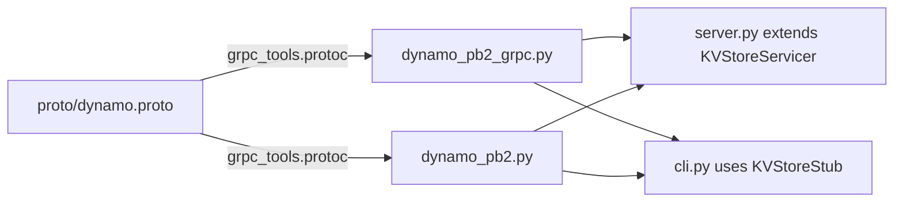

# 1.1 — gRPC API Contract

## What we are doing

Defining exactly how a client talks to a node: which calls exist, what each request contains, and what each response returns. This is written once in a `.proto` file, and gRPC generates the Python code for both the server and the client from it.

## Why gRPC

- **One contract for both sides.** Server and client are generated from the same file, so they cannot disagree on field names or types.
- **Typed messages.** A wrong field type fails immediately instead of causing a silent bug.
- **Fast binary format** (Protocol Buffers) instead of JSON over HTTP.
- **Reused later.** Phase 2 adds node-to-node calls to the same file.

## What we implement

The Phase 1 subset of the full spec. Fields needed only in later phases are reserved now so the message numbers never change.

```protobuf
syntax = "proto3";

package dynamo;

service KVStore {
  rpc Put(PutRequest) returns (PutResponse);
  rpc Get(GetRequest) returns (GetResponse);
  rpc Delete(DeleteRequest) returns (DeleteResponse);
}

enum Status {
  OK = 0;
  NOT_FOUND = 1;
  QUORUM_FAILED = 2;
  INVALID = 3;
}

message PutRequest {
  string key = 1;
  bytes value = 2;
  bytes context = 3;
  uint32 w = 4;
}

message PutResponse {
  Status status = 1;
  bytes context = 2;
  repeated string written_to = 3;
}

message GetRequest {
  string key = 1;
  uint32 r = 2;
}

message GetResponse {
  Status status = 1;
  repeated bytes values = 2;
  bytes context = 3;
  repeated string read_from = 4;
}

message DeleteRequest {
  string key = 1;
  bytes context = 2;
  uint32 w = 3;
}

message DeleteResponse {
  Status status = 1;
}
```

### Which fields Phase 1 actually uses

| Message            | Used now                                    | Ignored until later                             |
| ------------------ | ------------------------------------------- | ----------------------------------------------- |
| `PutRequest`     | `key`, `value`                          | `context` (phase 3), `w` (phase 2)          |
| `PutResponse`    | `status`                                  | `context` (phase 3), `written_to` (phase 2) |
| `GetRequest`     | `key`                                     | `r` (phase 2)                                 |
| `GetResponse`    | `status`, `values` (always 0 or 1 item) | `context` (phase 3), `read_from` (phase 2)  |
| `DeleteRequest`  | `key`                                     | `context` (phase 3), `w` (phase 2)          |
| `DeleteResponse` | `status`                                  | —                                              |

`values` is a list from the start because Phase 3 returns several sibling versions. Keeping it a list now means the client never changes shape.

### Status meanings in Phase 1

| Status            | When                                                |
| ----------------- | --------------------------------------------------- |
| `OK`            | Request succeeded                                   |
| `NOT_FOUND`     | `Get` on a key that does not exist or was deleted |
| `INVALID`       | Empty key, or key longer than 256 bytes             |
| `QUORUM_FAILED` | Not used until Phase 2                              |

Errors that are part of normal operation are returned as a `Status`, not as gRPC exceptions. A gRPC exception means something unexpected went wrong (server down, bug).

## How we implement it

1. Install the tools:

   ```
   pip install grpcio grpcio-tools
   ```
2. Save the contract as `proto/dynamo.proto`.
3. Generate the Python code into the `dynamo/` package:

   ```
   python -m grpc_tools.protoc -I proto --python_out=dynamo --grpc_python_out=dynamo proto/dynamo.proto
   ```
4. This creates two files. Never edit them by hand; regenerate after any change to the `.proto`.

   | File                   | Contains                                                                     |
   | ---------------------- | ---------------------------------------------------------------------------- |
   | `dynamo_pb2.py`      | Message classes:`PutRequest`, `GetResponse`, `Status`, …              |
   | `dynamo_pb2_grpc.py` | `KVStoreServicer` (base class for the server) and `KVStoreStub` (client) |
5. Fix the import in `dynamo_pb2_grpc.py` if needed: change `import dynamo_pb2` to `from dynamo import dynamo_pb2`. Add this as a step in a small `make proto` script so it is never forgotten.

## Flow



## Done when

- [ ] `proto/dynamo.proto` exists with the messages above
- [ ] Generated files import cleanly: `python -c "from dynamo import dynamo_pb2, dynamo_pb2_grpc"`
- [ ] Regeneration is one command
