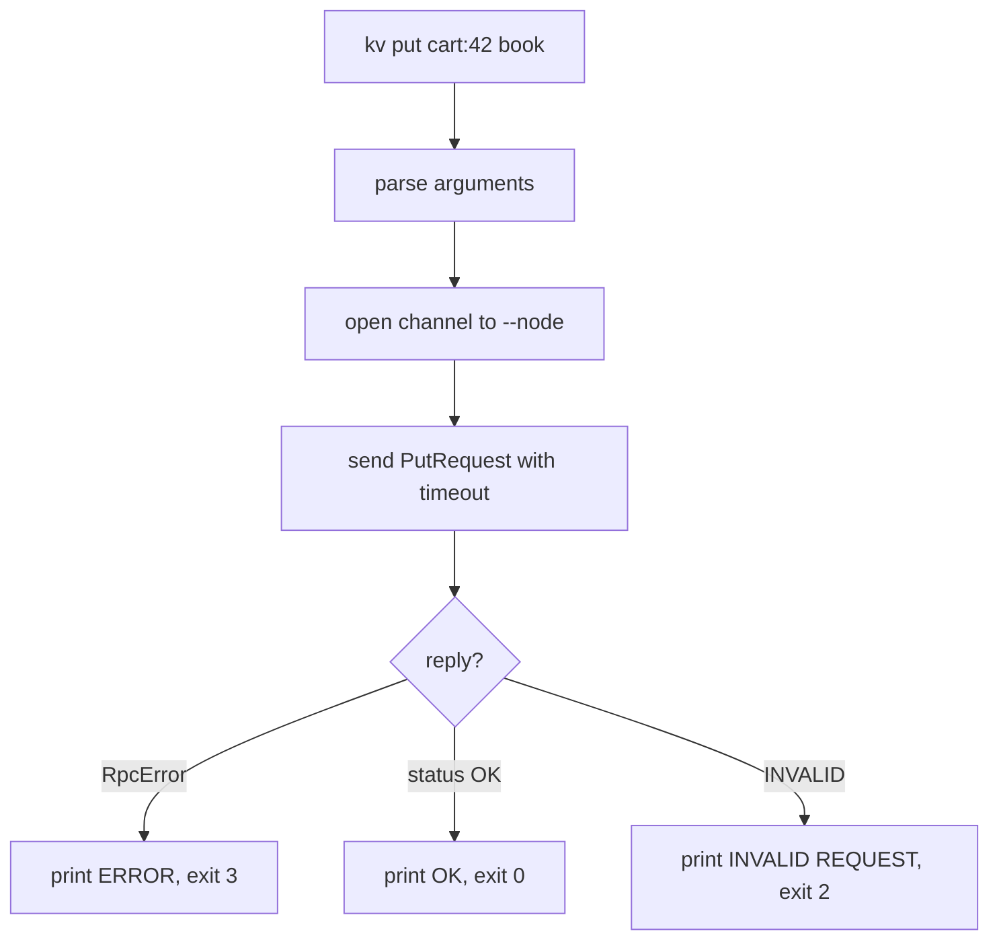

# 1.4 — CLI Client

## What we are doing

Building `kv`, a small command-line tool to talk to a node. It is how we use and demo the system without writing code each time.

## What we implement

### Commands

```
kv [--node HOST:PORT] put KEY VALUE
kv [--node HOST:PORT] get KEY
kv [--node HOST:PORT] delete KEY
```

`--node` defaults to `localhost:50051`, or the `KV_NODE` environment variable if it is set.

### Output and exit codes

Scripts (like the demo script in 1.5) rely on exit codes, so they are part of the design.

| Situation | Prints | Exit code |
|-----------|--------|-----------|
| `put` succeeded | `OK` | 0 |
| `get` found the key | the value | 0 |
| `get` key missing | `NOT FOUND` | 1 |
| `delete` succeeded | `OK` | 0 |
| Server returned `INVALID` | `INVALID REQUEST` | 2 |
| Node unreachable or timed out | `ERROR: cannot reach HOST:PORT` | 3 |

Output goes to stdout; errors go to stderr.

### Value encoding

The CLI takes the value as text and sends it as UTF-8 bytes. On `get` it decodes the bytes as UTF-8; if that fails it prints them in base64 with a `base64:` prefix. This keeps the server bytes-only while the CLI stays friendly.

### Optional flags (added now, used from Phase 2)

| Flag | Command | Meaning |
|------|---------|---------|
| `--timeout SECONDS` | all | gRPC deadline, default 2 s |
| `--w N` | put, delete | Write quorum (ignored by a single node) |
| `--r N` | get | Read quorum (ignored by a single node) |

## How we implement it

1. `argparse` with one sub-parser per command.
2. Open a channel: `grpc.insecure_channel(node)` and create `KVStoreStub(channel)`.
3. Build the request message and call the stub with `timeout=args.timeout`.
4. Map the response `status` to the output and exit code in the table above.
5. Catch `grpc.RpcError`: `UNAVAILABLE` or `DEADLINE_EXCEEDED` → exit code 3.
6. Register the command in `pyproject.toml` (or a tiny `kv` shell script) so it runs as `kv` instead of `python client/cli.py`:

   ```toml
   [project.scripts]
   kv = "client.cli:main"
   ```

Context storage for vector clocks is deliberately left out until Phase 3, when `Get` starts returning a context.

## Flow



## Tests

Run against a server started as in 1.3.

- [ ] `kv put a 1` prints `OK`, exit 0
- [ ] `kv get a` prints `1`, exit 0
- [ ] `kv get missing` prints `NOT FOUND`, exit 1
- [ ] `kv delete a` then `kv get a` gives exit 1
- [ ] `kv --node localhost:59999 get a` with nothing on that port gives exit 3 within the timeout
- [ ] Values with spaces work when quoted: `kv put greeting "hello world"`

## Done when

- [ ] All commands work against a local node
- [ ] Exit codes match the table, so the demo script can check them
