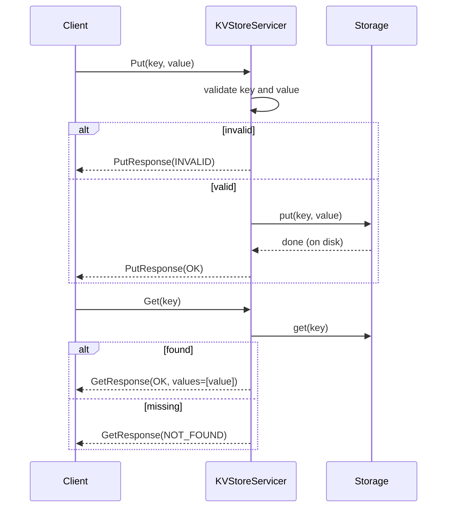
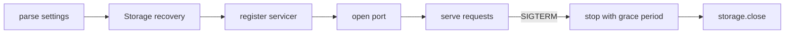

# 1.3 — gRPC Server

## What we are doing

Building `server.py`, the process that turns a node into a network service. It listens on a port, receives `Put`, `Get` and `Delete` calls, checks them, passes them to the storage engine, and sends back a response.

It is the glue between 1.1 (the contract) and 1.2 (the storage).

## What we implement

### Node startup settings

Read from command-line flags, with environment variables as fallback so Docker can set them.

| Flag | Env var | Default | Meaning |
|------|---------|---------|---------|
| `--node-id` | `NODE_ID` | `node1` | Name of this node; used for the data folder and logs |
| `--port` | `PORT` | `50051` | Port to listen on |
| `--data-dir` | `DATA_DIR` | `./data` | Parent folder; storage uses `<data-dir>/<node-id>` |
| `--checkpoint-every` | `CHECKPOINT_EVERY` | `1000` | Writes between snapshots |

### Request handling

| Call | Validation | Action | Response |
|------|------------|--------|----------|
| `Put` | key not empty, key ≤ 256 bytes, value ≤ 1 MB | `storage.put(key, value)` | `OK` |
| `Get` | key not empty, key ≤ 256 bytes | `storage.get(key)` | `OK` + `values=[value]`, or `NOT_FOUND` + empty list |
| `Delete` | key not empty, key ≤ 256 bytes | `storage.delete(key)` | `OK` (also when the key did not exist) |
| any | fails validation | nothing | `INVALID` |

`Delete` of a missing key returns `OK` so that retries are safe: deleting twice has the same result as deleting once.

### Logging

One line per request at INFO level: node ID, call, key, status, time taken in ms. This helps during the demo and in Phase 2 when requests jump between nodes.

```
node1 PUT cart:42 OK 3.1ms
node1 GET cart:99 NOT_FOUND 0.2ms
```

## How we implement it

### Structure

```
class KVStoreServicer(dynamo_pb2_grpc.KVStoreServicer):
    __init__(storage)
    Put(request, context)
    Get(request, context)
    Delete(request, context)

main():
    parse settings
    storage = Storage(folder)        # recovery happens here
    create gRPC server, register servicer
    listen on port
    wait for SIGTERM / Ctrl+C
    stop server, storage.close()
```

### Sync or async?

Phase 1 uses the standard thread-pool gRPC server (`grpc.server(ThreadPoolExecutor(max_workers=16))`):

- Storage writes call `fsync`, which blocks. In a thread pool, a blocked thread does not stop other requests.
- The lock inside `Storage` keeps writes in order.
- It is simpler to write and debug.

In Phase 2 the coordinator must call several replicas in parallel and wait for the first W replies. That is where `grpc.aio` and `asyncio` pay off, so the switch happens then. Blocking storage calls will be wrapped with `asyncio.to_thread`.

### Startup order

Storage recovery must finish **before** the server opens its port. Otherwise a client could read before the old data is loaded and wrongly get `NOT_FOUND`.

### Shutdown

On SIGTERM (what `docker stop` sends) or Ctrl+C:

1. `server.stop(grace=2)`: stop accepting new calls and let running ones finish.
2. `storage.close()`: close the log file.

A hard kill (`kill -9`) skips both steps. That is fine: every acknowledged write was already fsynced, which is exactly what the demo proves.

## Flow





## Tests (`tests/test_server.py`)

Start the server in-process on a random free port with a temporary data folder, then call it through a real `KVStoreStub`.

- [ ] `Put` then `Get` returns the value
- [ ] `Get` on a missing key returns `NOT_FOUND` with no values
- [ ] `Delete` then `Get` returns `NOT_FOUND`
- [ ] `Delete` on a missing key returns `OK`
- [ ] Empty key returns `INVALID` for all three calls
- [ ] Stop the server, start a new one on the same data folder: earlier keys are present
- [ ] 100 concurrent `Put` calls from threads all succeed and are all readable afterwards

## Done when

- [ ] `python -m dynamo.server --node-id node1 --port 50051` starts and logs that it is listening
- [ ] All tests above pass
