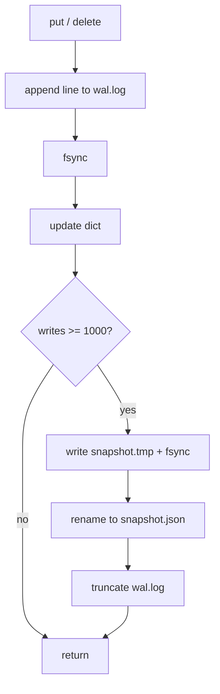
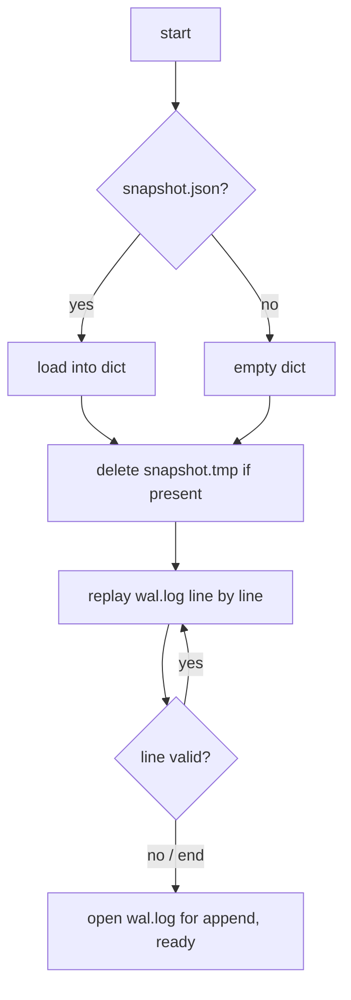

# 1.2 — Storage Engine

## What we are doing

Building `storage.py`, the part of a node that holds the data. It keeps every key in memory for fast reads and writes every change to disk so nothing is lost when the process dies.

This module knows nothing about gRPC or networking. It is a plain Python class, which makes it easy to test on its own.

## Why this design

| Approach | Problem |
|----------|---------|
| Dict only | Everything is lost when the process stops |
| Rewrite a JSON file of the whole dict on every write | Slow (rewrites all data every time) and a crash mid-rewrite corrupts the file |
| **Dict + write-ahead log + periodic snapshot** | Fast writes (append one line), fast reads (from memory), safe on crash |

This is the same pattern as PostgreSQL (WAL + checkpoint), Redis (AOF + RDB) and Cassandra (commit log + SSTable flush).

## What we implement

### Files on disk (one set per node)

```
/data/<node_id>/
  wal.log          # every change since the last snapshot, one JSON line each
  snapshot.json    # full copy of the dict at the last checkpoint
  snapshot.tmp     # exists only while a snapshot is being written
```

### Log record format

One JSON object per line. Values are bytes, so they are stored as base64.

```
{"op": "put", "key": "cart:42", "value": "Ym9vaw=="}
{"op": "delete", "key": "cart:42"}
```

### Snapshot format

```
{"cart:42": "Ym9vaw==", "user:7": "UHJhdGVlaw=="}
```

### Public interface

| Method | Behaviour |
|--------|-----------|
| `Storage(folder, checkpoint_every=1000)` | Creates the folder if needed and recovers data from disk |
| `put(key, value: bytes)` | Logs the write, fsyncs, updates the dict |
| `get(key) -> bytes or None` | Reads from the dict only; never touches disk |
| `delete(key)` | Logs the delete, fsyncs, removes from the dict |
| `checkpoint()` | Writes a snapshot and clears the log |
| `close()` | Closes the log file cleanly |

In Phase 3 the stored value becomes a list of versions with vector clocks. Only the record contents change; this interface and the log mechanics stay the same.

## How we implement it

### Write path (`put` and `delete`)

Order matters. The client must only hear OK after the change is on disk.

1. Build the record, for example `{"op": "put", "key": k, "value": base64(v)}`.
2. Append it to `wal.log` as one line.
3. `flush()` then `os.fsync()` so it reaches the physical disk, not just the OS cache.
4. Apply the record to the dict.
5. Increase the write counter. If it reaches `checkpoint_every`, run `checkpoint()`.
6. Return. The server can now reply OK.

### Recovery path (constructor)

1. Start with an empty dict.
2. If `snapshot.json` exists, load it into the dict.
3. If `snapshot.tmp` exists, delete it. It is a leftover from a crash during a checkpoint and the real snapshot is still valid.
4. Read `wal.log` line by line and apply each record.
5. If a line cannot be parsed, stop there. It is a torn last line from a crash mid-append and was never acknowledged.
6. Open `wal.log` in append mode for new writes.

### Checkpoint

1. Write the whole dict to `snapshot.tmp`.
2. `flush()` and `fsync()` it.
3. `os.replace("snapshot.tmp", "snapshot.json")`. This rename is atomic: after a crash you have either the old or the new snapshot, never half of one.
4. Only now truncate `wal.log` and reset the counter.

**Rule:** never clear the log before the snapshot is safely on disk.

### Crash at each point

| Crash happens | State after restart |
|---------------|---------------------|
| Before the log append | Write never happened; client got an error |
| In the middle of the append | Torn last line is skipped; client never got OK |
| After fsync, before OK | Write is kept; client may retry, which is harmless |
| During snapshot write | `snapshot.tmp` is deleted; old snapshot + full log are used |
| After rename, before log truncate | New snapshot + old log are replayed; replaying already-applied records gives the same result |

The last row works because applying the same `put` or `delete` twice leaves the same state (the records are idempotent).

### Concurrency

The server handles requests concurrently, so writes are serialized with a lock inside `Storage` (`threading.Lock` around the write path). Reads do not need the lock in Phase 1 because a single dict lookup is atomic in CPython.

## Flow





## Tests (`tests/test_storage.py`)

- [ ] `put` then `get` returns the value
- [ ] `delete` then `get` returns `None`
- [ ] Create, write, drop the object without `close()`, create again: data is present
- [ ] Append a half line to `wal.log` manually: recovery succeeds and earlier keys are present
- [ ] After `checkpoint_every` writes, `snapshot.json` exists and `wal.log` is empty
- [ ] Leave a fake `snapshot.tmp`: recovery ignores and removes it
- [ ] Deleted key does not come back after a restart

## Done when

- [ ] All tests above pass
- [ ] No acknowledged write is lost after `kill -9` (checked again in 1.5)
