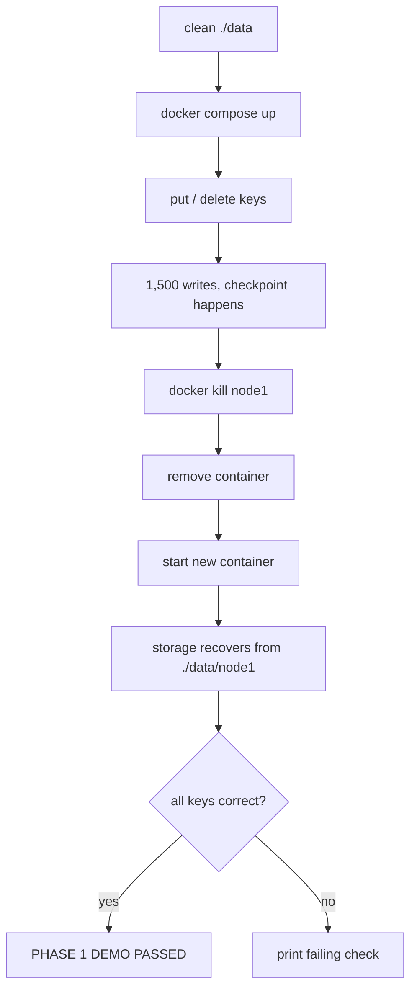

# 1.5 — Docker, Tests and Demo

## What we are doing

Packaging the node into a Docker container, mounting its data folder from the host so data survives the container, collecting all tests into one run, and writing a demo script that proves the Phase 1 goal: **a killed node comes back with all its data.**

Docker is set up now, with one node, so Phase 2 only has to add more services to the same compose file.

## What we implement

### Files

| File | Purpose |
|------|---------|
| `requirements.txt` | `grpcio`, `grpcio-tools`, `pytest` |
| `Dockerfile` | Image that runs one node |
| `docker-compose.yml` | Starts `node1` with its data folder mounted |
| `scripts/demo_phase1.sh` | Runs the crash-recovery demo end to end |
| `tests/` | `test_storage.py`, `test_server.py`, `test_cli.py` |

### Dockerfile plan

1. Base image `python:3.11-slim`.
2. Copy `requirements.txt`, `pip install`.
3. Copy the project, generate the gRPC code (so the image never depends on files generated on your laptop).
4. `CMD ["python", "-m", "dynamo.server"]`. Settings come from environment variables.

### docker-compose.yml plan

```yaml
services:
  node1:
    build: .
    environment:
      NODE_ID: node1
      PORT: "50051"
      DATA_DIR: /data
    ports:
      - "50051:50051"
    volumes:
      - ./data:/data
```

The `volumes` line is what makes persistence work in Docker. The node writes to `/data/node1/wal.log` inside the container, but the file really lives in `./data/node1/` on your laptop. Removing the container does not remove the file.

## How we implement it

### Demo script (`scripts/demo_phase1.sh`)

Each step prints what it is doing so it can be run live in the presentation.

1. Clean start: `docker compose down`, delete `./data`.
2. `docker compose up -d --build`, wait until the port answers.
3. Write keys: `kv put cart:42 book`, `kv put user:7 prateek`, then `kv delete user:7`.
4. Write 1,500 more keys in a loop so at least one checkpoint happens.
5. Show the files: `ls -l data/node1/` (snapshot exists, log is short).
6. **Hard crash:** `docker kill node1` (sends SIGKILL, like a power cut; no graceful shutdown).
7. Remove the container entirely: `docker compose rm -f node1`.
8. Start a brand new container: `docker compose up -d`.
9. Check:
   - `kv get cart:42` prints `book`
   - `kv get user:7` prints `NOT FOUND` (the delete survived too)
   - a sample of the 1,500 keys are all present
10. Print `PHASE 1 DEMO PASSED` or the first failing check, using the CLI exit codes from 1.4.

### Extra crash test (torn write)

Covered by unit tests in 1.2, and shown in the demo if time allows:

1. Stop the node.
2. Append half a JSON line to `data/node1/wal.log` by hand.
3. Start the node: it starts normally and all earlier keys are present.

### Running all tests

```
pytest -v tests/
```

| Test file | Covers | From |
|-----------|--------|------|
| `test_storage.py` | WAL, recovery, torn line, checkpoint, tombstone of deletes | 1.2 |
| `test_server.py` | gRPC calls, validation, restart, concurrency | 1.3 |
| `test_cli.py` | Commands, output, exit codes | 1.4 |

## Flow



## Done when

- [ ] `pytest -v tests/` passes
- [ ] `scripts/demo_phase1.sh` prints `PHASE 1 DEMO PASSED`
- [ ] The demo uses `docker kill`, not `docker stop`, so it proves crash safety and not just clean shutdown
- [ ] Phase 1 checklist in `phase1/README.md` is fully ticked
