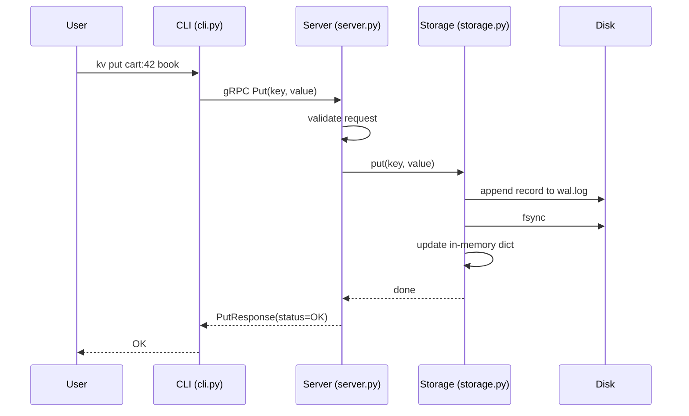
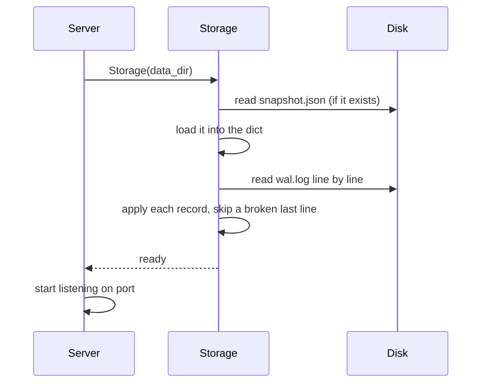

# Phase 1 — Single Node Key-Value Store

## Goal

Build one node that stores keys and values, answers requests over gRPC, and keeps its data after a crash or restart.

At the end of this phase:

```
kv put cart:42 book      ->  OK
(kill the node, start it again)
kv get cart:42           ->  book
```

Phase 1 covers capabilities **C1** (store, read, delete a key) and **C10** (survive a restart without losing data).

There is no clustering yet. Everything built here is reused in later phases: the storage engine becomes each replica's local store, and the gRPC server grows into the coordinator.

## Subphases

Build in this order. Each subphase has its own README.

| #   | Subphase                                           | What it produces                                                 | Depends on |
| --- | -------------------------------------------------- | ---------------------------------------------------------------- | ---------- |
| 1.1 | [gRPC API contract](1.1-grpc-api/README.md)         | `dynamo.proto` and generated Python code                       | —         |
| 1.2 | [Storage engine](1.2-storage/README.md)             | `storage.py`: dict + write-ahead log + snapshots               | —         |
| 1.3 | [gRPC server](1.3-server/README.md)                 | `server.py`: serves `Put`, `Get`, `Delete` using storage | 1.1, 1.2   |
| 1.4 | [CLI client](1.4-cli/README.md)                     | `kv` command: `put`, `get`, `delete`                     | 1.1, 1.3   |
| 1.5 | [Docker, tests and demo](1.5-docker-demo/README.md) | Dockerfile, compose file, pytest suite, demo script              | 1.1–1.4   |

1.1 and 1.2 are independent, so they can be built in either order.

## Folder layout after Phase 1

```
dynamo-kv/
  proto/
    dynamo/
      dynamo.proto           # under proto/dynamo/ so protoc emits `from dynamo import dynamo_pb2`
  dynamo/
    __init__.py
    dynamo_pb2.py            # generated, gitignored
    dynamo_pb2_grpc.py       # generated, gitignored
    storage.py
    server.py
  client/
    __init__.py
    cli.py
  scripts/
    gen_proto.sh
    bulk_write.py
    demo_phase1.sh
  tests/
    conftest.py
    test_storage.py
    test_server.py
    test_cli.py
  readme/
    phase1/                  # these design READMEs
  data/                      # created at runtime, mounted into the container, gitignored
  Dockerfile
  docker-compose.yml
  .dockerignore
  .gitignore
  requirements.txt
  pyproject.toml
  Makefile
  README.md
```

## End-to-end flow of one write



A read is shorter: `Get` goes CLI → server → storage, and storage answers from the in-memory dict without touching the disk.

## End-to-end flow of a restart



## Definition of done

- [ ] `kv put`, `kv get`, `kv delete` work against a running node
- [ ] Killing the node with `kill -9` and restarting it loses no acknowledged write
- [ ] A broken last line in `wal.log` does not stop the node from starting
- [ ] Snapshot is written every 1,000 writes and the log is cleared after it
- [ ] All tests in `tests/` pass
- [ ] Demo runs inside Docker with the data folder mounted from the host
