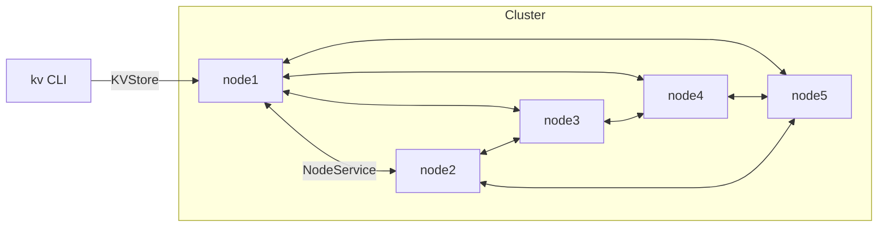
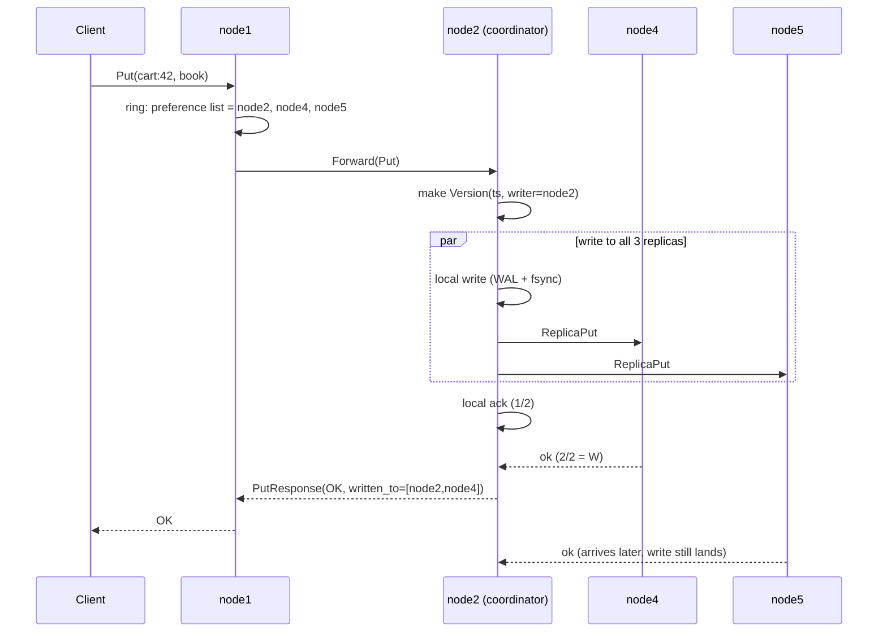
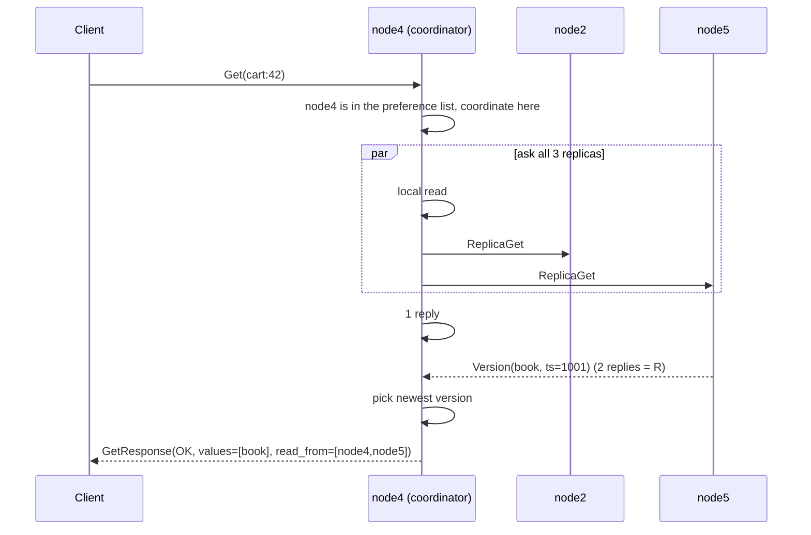

# Phase 2 — Static Cluster with Quorum

## Goal

Turn the single node from Phase 1 into a cluster of 5 nodes that share the data:

- every key lives on **N = 3** nodes, chosen by consistent hashing
- a client can send any request to **any** node
- a write succeeds when **W** replicas confirm it, a read when **R** replicas answer
- the cluster keeps working when one node is down

At the end of this phase:

```
kv --node localhost:50051 put cart:42 book -v   ->  OK  (written to node2, node4, node5)
kv --node localhost:50054 get cart:42 -v        ->  book (read from node4, node5)
docker compose kill node2
kv --node localhost:50051 put cart:42 pen       ->  OK  (still works with N=3, W=2)
kv --node localhost:50051 put cart:42 pen --w 3 ->  QUORUM FAILED
```

Phase 2 covers capabilities **C2** (spread keys evenly), **C3** (ask any node), **C4** (keep N copies) and **C5** (choose consistency per request).

## What is NOT in Phase 2

| Missing piece              | What goes wrong without it                                               | Added in |
| -------------------------- | ------------------------------------------------------------------------ | -------- |
| Vector clocks              | Two concurrent writes: one is silently lost (last-write-wins)            | Phase 3  |
| Read repair                | A replica that missed a write stays stale until the key is written again | Phase 3  |
| Gossip / failure detection | Nodes do not know who is down; they find out by timing out               | Phase 3  |
| Hinted handoff             | A node that was down never receives the writes it missed                 | Phase 4  |

These gaps are visible in the Phase 2 demo on purpose. Each later phase fixes one of them, which makes a good story for the presentation and for interviews.

## Subphases

Build in this order. Each subphase has its own README.

| #   | Subphase                                                           | What it produces                                                    | Depends on |
| --- | ------------------------------------------------------------------ | ------------------------------------------------------------------- | ---------- |
| 2.1 | [Cluster config and API](2.1-config-and-api/README.md)              | `cluster.yaml`, `config.py`, extended `dynamo.proto`          | Phase 1    |
| 2.2 | [Consistent hash ring](2.2-hash-ring/README.md)                     | `ring.py`: virtual nodes, preference list                         | 2.1        |
| 2.3 | [Versioned storage](2.3-versioned-storage/README.md)                | `storage.py` stores versions (LWW timestamp) and tombstones       | Phase 1    |
| 2.4 | [Async server and peer calls](2.4-async-server-and-peers/README.md) | `grpc.aio` server, `peers.py`, `NodeService` replica handlers | 2.1, 2.3   |
| 2.5 | [Coordinator](2.5-coordinator/README.md)                            | `coordinator.py`: routing, forwarding, quorum reads and writes    | 2.2, 2.4   |
| 2.6 | [Cluster, CLI, tests and demo](2.6-cluster-demo/README.md)          | 5-node Docker Compose, CLI updates, cluster tests, demo script      | 2.1–2.5   |

2.2 and 2.3 do not depend on each other, so they can be built in either order.

## What changes from Phase 1

| Area                                                  | Phase 1          | Phase 2                                                                                   |
| ----------------------------------------------------- | ---------------- | ----------------------------------------------------------------------------------------- |
| Nodes                                                 | 1                | 5, listed in`cluster.yaml`                                                              |
| Server                                                | Thread-pool gRPC | `grpc.aio` + `asyncio` (needed to call replicas in parallel)                          |
| Stored value                                          | Raw bytes        | `Version`: value + timestamp + writer + tombstone flag                                  |
| Delete                                                | Removes the key  | Writes a**tombstone**, so a stale replica cannot bring the key back                 |
| Who answers a request                                 | The node itself  | A**coordinator**, which talks to the N replicas                                     |
| `PutResponse.written_to`, `GetResponse.read_from` | Empty            | Filled with node IDs                                                                      |
| `w`, `r` fields                                   | Ignored          | Used, default from config                                                                 |
| Data folder                                           | `data/node1/`  | `data/node1/` … `data/node5/` (Phase 1 data must be deleted; the log format changed) |

The storage engine's log and snapshot mechanics from Phase 1 do not change. Only the record contents change.

## Folder layout after Phase 2

```
dynamo-kv/
  proto/dynamo/dynamo.proto        # extended
  cluster.yaml                     # NEW: used inside Docker
  cluster.local.yaml               # NEW: 5 nodes on localhost
  dynamo/
    config.py                      # NEW
    ring.py                        # NEW
    version.py                     # NEW: Version dataclass + compare
    storage.py                     # changed: stores Versions
    peers.py                       # NEW: gRPC clients to other nodes
    coordinator.py                 # NEW
    server.py                      # changed: grpc.aio, two services
  client/cli.py                    # changed: -v, info, locate, local-get
  scripts/
    bulk_write.py                  # changed: spreads writes over nodes
    key_spread.py                  # NEW: key count per node
    demo_phase2.sh                 # NEW
  tests/
    test_ring.py                   # NEW
    test_storage.py                # changed
    test_config.py                 # NEW
    test_cluster.py                # NEW: in-process 5-node cluster
  docker-compose.yml               # 5 services
```

## Architecture



Every node runs the same code and serves two gRPC services on one port:

| Service         | Called by        | Purpose                                                                                  |
| --------------- | ---------------- | ---------------------------------------------------------------------------------------- |
| `KVStore`     | Clients          | `Put`, `Get`, `Delete`, plus debug calls `ClusterInfo`, `Locate`, `LocalGet` |
| `NodeService` | Other nodes only | `Forward`, `ReplicaPut`, `ReplicaGet`                                              |

## End-to-end flow of one write

Example: `put cart:42` sent to node1, N=3, W=2. The ring says the key belongs to node2, node4, node5.



If node1 had been in the preference list itself, it would coordinate directly and skip the `Forward` hop.

## End-to-end flow of one read



## Why R + W > N matters

With N=3, R=2, W=2, every write reaches at least 2 of the 3 replicas, and every read asks at least 2 of the 3. Two groups of 2 out of 3 always share at least one node, so every read sees the latest successful write (as long as nodes are not replaced by stand-ins, which only happens in Phase 4).

| N, R, W | R + W > N | Behaviour                                                   |
| ------- | --------- | ----------------------------------------------------------- |
| 3, 2, 2 | yes       | Balanced default; survives 1 node down for reads and writes |
| 3, 1, 3 | yes       | Fast reads, writes fail if any replica is down              |
| 3, 3, 1 | yes       | Fast writes, reads fail if any replica is down              |
| 3, 1, 1 | no        | Fastest, but a read can miss the latest write               |

## Definition of done

- [ ] 5 nodes run in Docker Compose from one `cluster.yaml`
- [ ] Any node accepts any request and gives the same answer
- [ ] Each key is stored on exactly the 3 nodes in its preference list
- [ ] 10,000 keys spread with no node holding more than 1.5× the average
- [ ] With one node killed, `N=3, R=2, W=2` reads and writes still succeed
- [ ] `--w 3` with a replica down returns `QUORUM_FAILED`; `--r` / `--w` greater than N returns `INVALID`
- [ ] A deleted key does not come back when a stale replica is read with R=2
- [ ] All tests in `tests/` pass and `scripts/demo_phase2.sh` prints `PHASE 2 DEMO PASSED`
