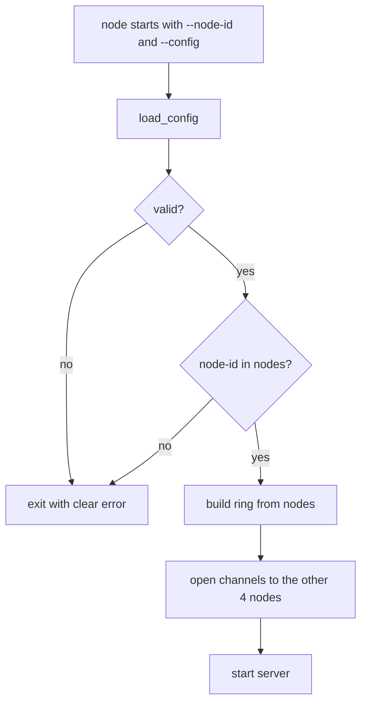

# 2.1 — Cluster Config and API

## What we are doing

Two things every other subphase depends on:

1. **A cluster config file** that tells every node who is in the cluster and what N, R, W are.
2. **The extended gRPC contract**: the new internal `NodeService`, the `Version` message, and three debug calls on `KVStore` that make the demo possible.

## Why a static config file

Phase 2 has no gossip, so nodes cannot discover each other. Instead, every node reads the same `cluster.yaml` at startup. Because they all read the same list, they all build the **same hash ring**, so every node agrees on where every key lives without talking to each other.

Phase 3 replaces "the list is fixed" with gossip, but the file stays as the list of **seed** nodes.

## What we implement

### `cluster.yaml` (used inside Docker)

```yaml
cluster:
  n: 3
  r: 2
  w: 2
  vnodes: 32
  rpc_timeout_ms: 500
  request_timeout_ms: 1500

nodes:
  - id: node1
    address: node1:50051
  - id: node2
    address: node2:50051
  - id: node3
    address: node3:50051
  - id: node4
    address: node4:50051
  - id: node5
    address: node5:50051
```

`cluster.local.yaml` is the same, with addresses `localhost:50051` … `localhost:50055`, for running 5 nodes on your laptop without Docker.

| Setting | Meaning |
|---------|---------|
| `n` | Copies of each key |
| `r` | Default replies needed for a read |
| `w` | Default acks needed for a write |
| `vnodes` | Ring positions per physical node |
| `rpc_timeout_ms` | How long the coordinator waits for one replica |
| `request_timeout_ms` | Upper limit for a whole client request, including a forward hop |

### `dynamo/config.py`

```python
@dataclass(frozen=True)
class NodeInfo:
    id: str
    address: str

@dataclass(frozen=True)
class ClusterConfig:
    n: int
    r: int
    w: int
    vnodes: int
    rpc_timeout_ms: int
    request_timeout_ms: int
    nodes: list[NodeInfo]

def load_config(path: str) -> ClusterConfig: ...
```

`load_config` checks these rules and raises `ValueError` with a clear message if one fails:

| Rule | Example error |
|------|---------------|
| Node IDs are unique | `duplicate node id: node3` |
| Addresses are `host:port` | `bad address for node2: node2` |
| `1 <= n <= number of nodes` | `n=6 but only 5 nodes` |
| `1 <= r <= n` and `1 <= w <= n` | `w=4 must be between 1 and n=3` |
| `vnodes >= 1` | — |

If `r + w <= n`, it does not fail but logs a warning: `r + w <= n: reads may miss the latest write`.

New dependency: `PyYAML`.

### Server settings (changed)

| Flag | Env var | Default | Change |
|------|---------|---------|--------|
| `--node-id` | `NODE_ID` | `node1` | must exist in the config |
| `--config` | `CONFIG` | `cluster.local.yaml` | **new** |
| `--port` | `PORT` | port from own address in config | now optional |
| `--data-dir` | `DATA_DIR` | `./data` | same |
| `--checkpoint-every` | `CHECKPOINT_EVERY` | `1000` | same |

### Extended `dynamo.proto`

Phase 1 messages (`PutRequest`, `PutResponse`, `GetRequest`, `GetResponse`, `DeleteRequest`, `DeleteResponse`, `Status`) stay **exactly as they are**. Additions:

```protobuf
service KVStore {
  rpc Put(PutRequest) returns (PutResponse);
  rpc Get(GetRequest) returns (GetResponse);
  rpc Delete(DeleteRequest) returns (DeleteResponse);
  rpc ClusterInfo(Empty) returns (ClusterInfoResponse);
  rpc Locate(LocateRequest) returns (LocateResponse);
  rpc LocalGet(LocalGetRequest) returns (LocalGetResponse);
}

service NodeService {
  rpc Forward(ForwardRequest) returns (ForwardResponse);
  rpc ReplicaPut(ReplicaPutRequest) returns (ReplicaPutResponse);
  rpc ReplicaGet(ReplicaGetRequest) returns (ReplicaGetResponse);
}

message Empty {}

message Version {
  bytes value = 1;
  // field 2 is kept free for VectorClock clock (Phase 3)
  bool tombstone = 3;
  int64 timestamp_ms = 4;
  string writer = 5;
}

message Member {
  string node_id = 1;
  string address = 2;
  // fields 3-5 kept free for heartbeat, state, incarnation (Phase 3)
}

message ClusterInfoResponse {
  string node_id = 1;
  repeated Member members = 2;
  uint32 n = 3;
  uint32 r = 4;
  uint32 w = 5;
  uint64 local_key_count = 6;
}

message LocateRequest { string key = 1; }
message LocateResponse {
  repeated string nodes = 1;
  uint32 ring_position = 2;
}

message LocalGetRequest { string key = 1; }
message LocalGetResponse {
  Status status = 1;
  Version version = 2;
  string node_id = 3;
}

message ForwardRequest {
  string sender = 1;
  oneof op {
    PutRequest put = 2;
    GetRequest get = 3;
    DeleteRequest delete = 4;
  }
}
message ForwardResponse {
  oneof result {
    PutResponse put = 1;
    GetResponse get = 2;
    DeleteResponse delete = 3;
  }
}

message ReplicaPutRequest {
  string sender = 1;
  string key = 2;
  Version version = 3;
  string hint_for = 4;
}
message ReplicaPutResponse {
  bool ok = 1;
  string node_id = 2;
}

message ReplicaGetRequest {
  string sender = 1;
  string key = 2;
}
message ReplicaGetResponse {
  string node_id = 1;
  repeated Version versions = 2;
}
```

### What each new message is for

| Message / RPC | Used for | Phase 2 notes |
|---------------|----------|---------------|
| `Version` | One stored value with its metadata | `timestamp_ms` + `writer` decide which version is newer (last-write-wins) |
| `ClusterInfo` | `kv info`: members, N/R/W, how many keys this node holds | Used by `key_spread.py` |
| `Locate` | `kv locate KEY`: which nodes should hold this key | Computed from the ring, no data read |
| `LocalGet` | `kv local-get KEY`: what **this** node has on disk, no coordination | Debug only; shows stale replicas in the demo |
| `Forward` | A non-replica node passes a client request to a replica | Never forwarded twice |
| `ReplicaPut` | Coordinator → replica: store this version | `hint_for` stays empty until Phase 4 |
| `ReplicaGet` | Coordinator → replica: send your version of this key | `versions` has 0 or 1 items until Phase 3 |

`ReplicaGetResponse.versions` is a list now so it does not change shape when Phase 3 adds siblings.

## How we implement it

1. Add `PyYAML` to `requirements.txt`.
2. Write `cluster.yaml` and `cluster.local.yaml`.
3. Write `config.py` with `load_config` and the checks above.
4. Replace `proto/dynamo/dynamo.proto` with the extended version and run `make proto`.
5. Confirm that the Phase 1 messages kept their field numbers. Changing a field number breaks old clients silently.

## Flow



## Tests (`tests/test_config.py`)

- [ ] `cluster.yaml` and `cluster.local.yaml` load without errors
- [ ] Duplicate node ID raises `ValueError`
- [ ] `n` greater than the number of nodes raises `ValueError`
- [ ] `w = 0` or `w > n` raises `ValueError`
- [ ] Address without a port raises `ValueError`
- [ ] `r + w <= n` loads but logs a warning (`caplog`)

## Done when

- [ ] Both config files load
- [ ] `make proto` generates code with both services
- [ ] `python -c "from dynamo import dynamo_pb2_grpc as g; g.NodeServiceStub; g.KVStoreStub"` works
