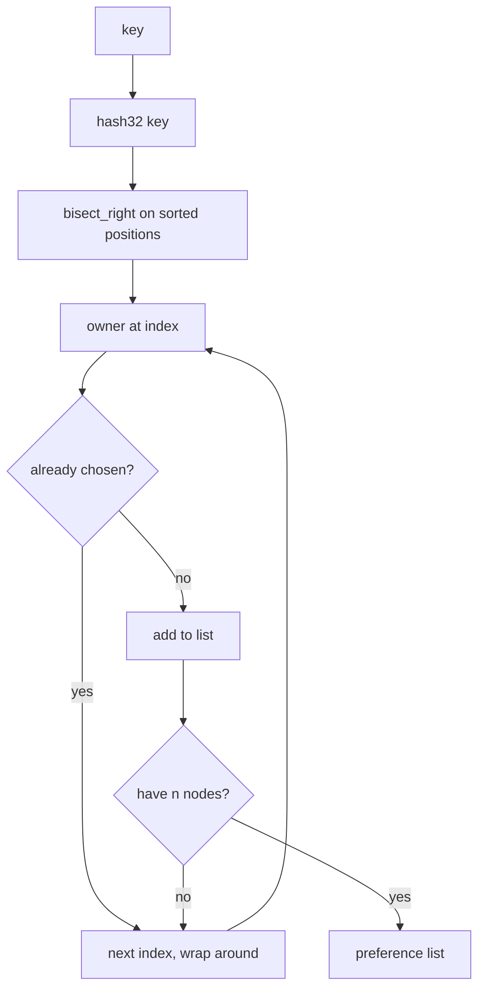

# 2.2 — Consistent Hash Ring

## What we are doing

Building `ring.py`, which answers one question: **which N nodes store this key?**

The answer is called the key's **preference list**. Every node builds the same ring from the same config, so every node computes the same preference list for every key without asking anyone.

`ring.py` is pure logic: no network, no disk. It is the easiest part of Phase 2 to test thoroughly.

## Why consistent hashing

The simple approach is `node = hash(key) % 5`. It breaks as soon as the number of nodes changes: with `% 6`, almost every key maps to a different node and would have to move.

On a ring, each node owns the arc in front of it. Adding or removing one node only changes the arcs next to it, so only about **1/N of keys move**. Phase 2 has a fixed node list, but this property matters in Phase 3 (nodes marked dead) and in the stretch goal (adding a node at runtime).

## Why virtual nodes

With one position per node, the arcs have random sizes, so one node may own 35% of keys and another 8%. Giving every physical node **32 positions** (virtual nodes) splits each node's share into many small arcs, and the totals even out.

| vnodes per node | Typical spread (5 nodes, 10,000 keys) |
|-----------------|---------------------------------------|
| 1 | Very uneven, some nodes 2–3× others |
| 32 | Each node within roughly ±20% of average |
| 128 | Within roughly ±10%, more memory and slower build |

32 is the default. Measuring this table yourself (optional `scripts/ring_stats.py`) gives a good graph for the report.

## What we implement

### Hash function

```python
def hash32(text: str) -> int:
    return int.from_bytes(hashlib.md5(text.encode()).digest()[:4], "big")
```

- MD5 is used for spreading keys evenly, not for security, so its weakness as a crypto hash does not matter here. It is also what the Dynamo paper used.
- 32 bits gives ring positions `0 … 2³² − 1`.
- Python's built-in `hash()` must **not** be used: it changes between processes, so nodes would disagree.

Virtual node positions: `hash32(f"{node_id}#{i}")` for `i` in `0 … vnodes-1`.

### Interface

```python
class Ring:
    def __init__(self, node_ids: list[str], vnodes: int) -> None: ...
    def position(self, key: str) -> int: ...
    def walk(self, key: str) -> Iterator[str]: ...
    def preference_list(self, key: str, n: int) -> list[str]: ...
    def owned_share(self) -> dict[str, float]: ...
```

| Method | Returns |
|--------|---------|
| `position(key)` | `hash32(key)` |
| `walk(key)` | Distinct physical node IDs in clockwise order starting after the key's position, each node once, all nodes eventually |
| `preference_list(key, n)` | First `n` items of `walk(key)`; `ValueError` if `n` > number of nodes |
| `owned_share()` | Fraction of the ring each node owns as **first** owner (used in tests and `ring_stats.py`) |

`walk` is a generator instead of a fixed list because Phase 4 needs to keep walking past the first N nodes to find stand-ins for dead nodes (sloppy quorum).

## How we implement it

### Building the ring

1. For each node and each `i < vnodes`, compute `(hash32(f"{node}#{i}"), node)`.
2. Sort the list by `(position, node_id)`. Sorting on both makes ties deterministic.
3. Keep two parallel lists: `positions` (sorted ints) and `owners` (node ID at each position).

### Walking from a key

1. `start = bisect.bisect_right(positions, hash32(key))`. This finds the first vnode **after** the key.
2. Go through indexes `start, start+1, …` wrapping around with `% len(positions)`.
3. Yield each owner the first time it is seen; skip vnodes of nodes already yielded.
4. Stop after every physical node has been yielded once.

Skipping duplicates is what makes the 3 replicas land on 3 **different machines**. Without it, two of a key's 3 copies could be two vnodes of the same node, and one crash would lose both.

### Example

```
ring positions (simplified):
  100:node3  250:node2  400:node3  520:node4  700:node5  880:node1  ...

key "cart:42" hashes to 230
walk:  250 node2 -> 400 node3 -> 520 node4 -> ...
preference_list(n=3) = [node2, node3, node4]
```

## Flow



## Tests (`tests/test_ring.py`)

- [ ] Same key gives the same preference list on two separately built `Ring` objects
- [ ] Preference list has `n` **distinct** node IDs for 1,000 random keys
- [ ] `walk(key)` yields every node exactly once
- [ ] `preference_list(key, 6)` with 5 nodes raises `ValueError`
- [ ] Node order in the constructor does not change any result
- [ ] Distribution: 10,000 keys, 5 nodes, 32 vnodes, each node is first owner for 10%–30% of keys
- [ ] `owned_share()` values add up to 1.0
- [ ] Minimal movement: build a ring with 5 nodes and one with node5 removed; only keys whose first owner was node5 change first owner (about 20%)
- [ ] Wrap-around: a key hashing above the largest position goes to the owner of the smallest position

## Done when

- [ ] All tests above pass
- [ ] `ring.py` imports nothing from gRPC, storage or config
