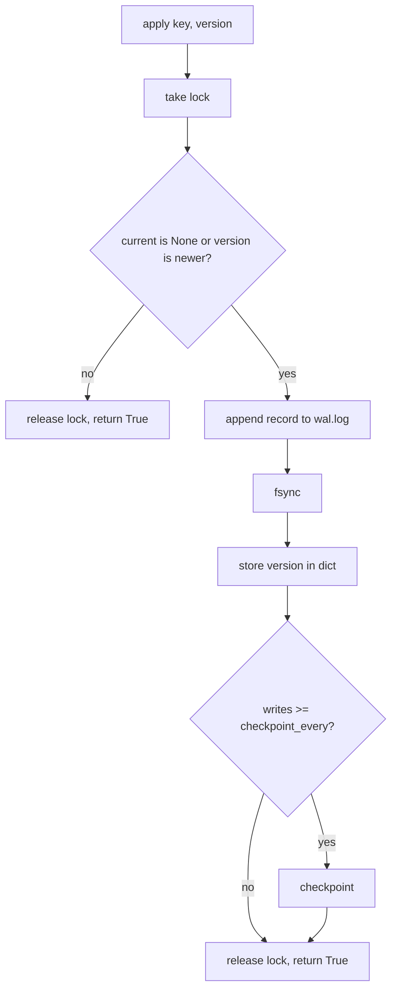

# 2.3 — Versioned Storage

## What we are doing

Changing what each node stores. In Phase 1 a key mapped to raw bytes. With replication, replicas can disagree (one missed a write), so every stored value now carries metadata that says **which version is newer**.

The WAL, fsync, snapshot and recovery mechanics from Phase 1 stay exactly the same. Only the record contents and the "should I apply this?" rule change.

## Why versions are needed now

Without versions, a coordinator that gets two different answers from two replicas has no way to pick the right one.

```
node2: book    node4: pen    -> which one is current?
```

Phase 2 answers with **last-write-wins (LWW)**: each version gets the coordinator's timestamp when it is written, and the larger timestamp wins.

Phase 3 replaces this with **vector clocks**, because LWW has two real problems. Both are worth knowing for interviews:

| Problem | Example |
|---------|---------|
| Concurrent writes are silently lost | Two users add different items to the same cart at the same moment; one item disappears with no error |
| Clock skew | If node3's clock is 2 s ahead, its writes beat newer writes from other nodes for 2 s |

In Docker on one laptop, all containers share the host clock, so skew does not show up in the demo. In a real data center it would.

## Why deletes become tombstones

In Phase 1, `delete` removed the key. With replicas that breaks:

1. `cart:42 = book` is on node2, node4, node5.
2. node5 is down. `delete cart:42` removes it from node2 and node4.
3. node5 comes back, still holding `book`.
4. A read that reaches node5 sees `book` and nothing to contradict it. **The deleted key is back.**

A **tombstone** is a version that says "deleted at time T". It is stored and replicated like any other write. In step 4 the read sees `tombstone@T2` from node2 and `book@T1` from node5; the tombstone is newer, so the answer is `NOT_FOUND`.

Tombstones are never removed in Phase 2. Purging them safely needs every replica to have seen them, which comes with anti-entropy (stretch goal).

## What we implement

### `dynamo/version.py`

```python
@dataclass(frozen=True)
class Version:
    value: bytes
    timestamp_ms: int
    writer: str
    tombstone: bool = False

def is_newer(a: Version, b: Version) -> bool:
    return (a.timestamp_ms, a.writer) > (b.timestamp_ms, b.writer)
```

Comparing `(timestamp_ms, writer)` as a pair means two writes in the same millisecond still have a fixed winner, chosen the same way on every node. Without the tie-break, two replicas could pick different winners.

Also add `to_proto(version)` and `from_proto(message)` helpers to convert to and from the protobuf `Version`.

### Storage interface (changed)

```python
class Storage:
    def __init__(self, folder: str, checkpoint_every: int = 1000) -> None: ...
    def apply(self, key: str, version: Version) -> bool: ...
    def get_version(self, key: str) -> Version | None: ...
    def key_count(self) -> int: ...
    def checkpoint(self) -> None: ...
    def close(self) -> None: ...
```

`put` and `delete` from Phase 1 are removed. A delete is now `apply(key, Version(b"", ts, writer, tombstone=True))`.

### The `apply` rule

```
current = data.get(key)
if current is None or is_newer(version, current):
    log it, fsync, store it        -> return True
else:
    do nothing                      -> return True  (already have this or newer)
```

`apply` returns `True` in both cases. For the coordinator, the question is "does this replica now hold this version or a newer one?", and both cases mean yes. Older versions are not written to the log, which saves disk and keeps replay fast.

`key_count()` counts keys whose current version is not a tombstone.

### Formats on disk

WAL line:
```
{"op": "put", "key": "cart:42", "value": "Ym9vaw==", "ts": 1759571234123, "writer": "node2", "tomb": false}
```

Snapshot:
```
{"cart:42": {"value": "Ym9vaw==", "ts": 1759571234123, "writer": "node2", "tomb": false}}
```

Replay during recovery goes through the same `is_newer` rule, so replaying a record twice, or replaying an old log on top of a newer snapshot, still ends in the correct state.

The format is not compatible with Phase 1 data. Delete `./data` when moving to Phase 2.

## How we implement it

1. Add `version.py` with the dataclass, `is_newer`, and the proto helpers.
2. Change the record builder and the replay code in `storage.py` to the new format.
3. Replace `put` / `delete` with `apply`, keeping the lock → log → fsync → update dict → maybe checkpoint order from Phase 1.
4. Keep the torn-line truncation logic from Phase 1 unchanged.
5. Update the Phase 1 storage tests to the new interface and add the ones below.

## Flow



## Tests (`tests/test_storage.py`, updated)

- [ ] `apply` then `get_version` returns the same version
- [ ] A newer version replaces an older one
- [ ] An older version is ignored, and the log does not grow
- [ ] Same timestamp, different writer: the larger writer ID wins, whichever arrives first
- [ ] A tombstone newer than the value wins; `key_count()` drops by 1
- [ ] A value newer than a tombstone wins (key comes back on purpose after a later put)
- [ ] Restart keeps the versions, including the timestamp and writer
- [ ] Old log replayed on top of a newer snapshot gives the correct final state
- [ ] All Phase 1 crash tests (torn line, torn line then new writes, leftover `snapshot.tmp`) still pass with the new format

## Done when

- [ ] All tests above pass
- [ ] No code outside `storage.py` and `version.py` changes in this subphase
