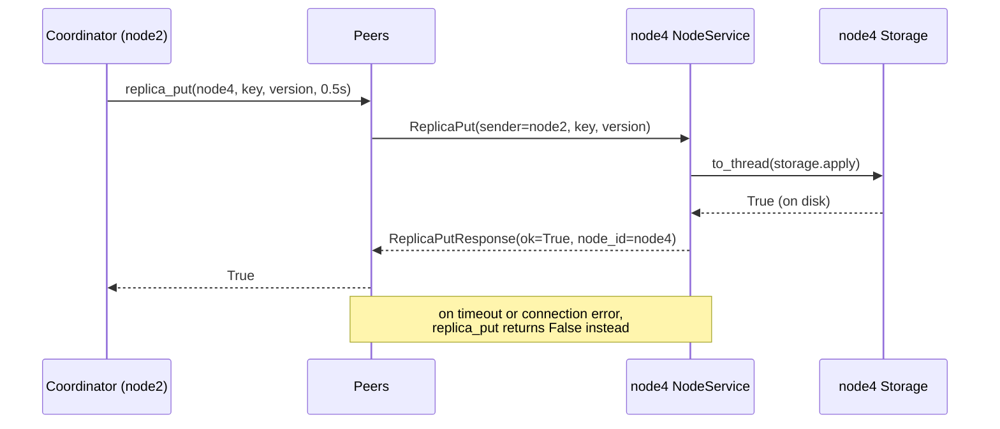

# 2.4 — Async Server and Peer Calls

## What we are doing

Three changes that let nodes talk to each other:

1. Moving the server from the thread-pool gRPC server to **`grpc.aio` with `asyncio`**.
2. Adding **`peers.py`**: one reusable gRPC client per other node.
3. Implementing the replica side of **`NodeService`** (`ReplicaPut`, `ReplicaGet`) and the debug calls (`ClusterInfo`, `Locate`, `LocalGet`).

The coordinator logic itself comes in 2.5. After this subphase, nodes can store and read versions on each other, but client `Put` / `Get` still only use the local node.

## Why switch to asyncio now

In Phase 2 a coordinator sends the same request to 3 replicas and must reply as soon as **W** of them answer, while the rest finish in the background.

| Approach | Problem |
|----------|---------|
| Call replicas one after another | Latency adds up: 3 × slowest call |
| A thread per call | Works, but waiting for "the first W of 3" and cancelling timeouts gets messy with threads |
| **asyncio** | `asyncio.as_completed` and `asyncio.wait_for` express "first W of N, with a deadline" directly |

The catch: storage calls are **blocking** (`fsync` can take milliseconds). Calling them directly inside an `async def` would freeze every other request on the node. So every storage call goes through `await asyncio.to_thread(...)`, which runs it in a worker thread while the event loop keeps serving others. The `threading.Lock` inside `Storage` still keeps writes in order.

## What we implement

### `dynamo/peers.py`

```python
class Peers:
    def __init__(self, config: ClusterConfig, self_id: str) -> None: ...
    async def replica_put(self, node_id: str, key: str, version: Version, timeout: float) -> bool: ...
    async def replica_get(self, node_id: str, key: str, timeout: float) -> Version | None | Failed: ...
    async def forward(self, node_id: str, request: ForwardRequest, timeout: float) -> ForwardResponse: ...
    async def close(self) -> None: ...
```

| Detail | Decision |
|--------|----------|
| Channels | One `grpc.aio.insecure_channel` per other node, created once at startup and reused. Opening a channel per call would add a TCP handshake to every request. |
| Self | `Peers` never holds a channel to its own node. The coordinator calls local storage directly. |
| Errors in `replica_put` | Any `grpc.RpcError` (unreachable, timeout) returns `False` and logs a WARNING with the node and error code. |
| Errors in `replica_get` | Returns a `Failed` marker, so the coordinator can tell "replica answered: no such key" (`None`) apart from "replica did not answer". |
| Errors in `forward` | Raises, because the caller (2.5) tries the next node. |
| Sender | Every request sets `sender = self_id`, which makes the logs readable and is needed for gossip in Phase 3. |

### `NodeService` replica handlers

| RPC | Action | Response |
|-----|--------|----------|
| `ReplicaPut` | `await to_thread(storage.apply, key, version)` | `ok=True`, `node_id=self` |
| `ReplicaGet` | `await to_thread(storage.get_version, key)` | `versions=[v]` or empty list, `node_id=self` |
| `Forward` | Stub that returns an empty response in this subphase; implemented in 2.5 | — |

A replica never checks whether it "should" own the key. The coordinator decides placement. This keeps replicas simple, and Phase 4 needs replicas that store keys they do not own anyway (hinted handoff).

### Debug handlers on `KVStore`

| RPC | Response |
|-----|----------|
| `ClusterInfo` | own node ID, all members from config, N/R/W, `local_key_count` |
| `Locate(key)` | `ring.preference_list(key, n)` and `ring.position(key)` |
| `LocalGet(key)` | This node's stored version, or `NOT_FOUND`. No other node is contacted. |

### Server structure (changed)

```
async def serve(settings):
    config = load_config(settings.config)
    storage = Storage(folder)                    # recovery first, as in Phase 1
    ring = Ring([n.id for n in config.nodes], config.vnodes)
    peers = Peers(config, settings.node_id)
    coordinator = Coordinator(...)               # 2.5; until then Put/Get stay local

    server = grpc.aio.server()
    add KVStoreServicer(coordinator, storage, ring, config)
    add NodeServiceServicer(storage, coordinator)
    server.add_insecure_port(f"[::]:{port}")
    await server.start()
    log "node2 listening on 50051 (recovered N keys, 5 members)"
    wait for SIGTERM / SIGINT
    await server.stop(grace=2)
    await peers.close()
    storage.close()

asyncio.run(serve(settings))
```

A test helper `async def start_node(config, node_id, data_dir, port=0) -> RunningNode` starts a node in the current event loop and returns an object with `.address`, `.stop()` and the internal parts. The cluster tests in 2.6 use it to run 5 nodes in one process.

### Startup order

1. Load and validate the config.
2. Recover storage (before the port opens, as in Phase 1).
3. Build the ring and the peer channels. Channels connect lazily, so it does not matter if other nodes are not up yet.
4. Open the port.

## How we implement it

1. Write `peers.py`.
2. Convert both servicers to `async def` methods and wrap every storage call in `asyncio.to_thread`.
3. Implement `ReplicaPut`, `ReplicaGet`, `ClusterInfo`, `Locate`, `LocalGet`.
4. Replace `create_server` from Phase 1 with `start_node`.
5. Update the Phase 1 server tests to the async helper (use `pytest-asyncio`, added to `requirements.txt` as a test dependency).

## Flow



## Tests

- [ ] Two nodes in one event loop: `replica_put` from A to B, then `LocalGet` on B returns the version
- [ ] `replica_get` for a missing key returns `None`; for a stopped node returns `Failed`
- [ ] `replica_put` to a stopped node returns `False` within the timeout
- [ ] An older version sent by `ReplicaPut` is acked but not stored
- [ ] `Locate` returns the same list on every node for the same key
- [ ] `ClusterInfo.local_key_count` matches what was written
- [ ] 50 concurrent `ReplicaPut` calls to one node all succeed (checks that `to_thread` + lock work together)

## Done when

- [ ] All tests above pass
- [ ] `make run` style startup works for 5 nodes on localhost using `cluster.local.yaml`
- [ ] No storage call is made directly inside an `async def` without `to_thread`
