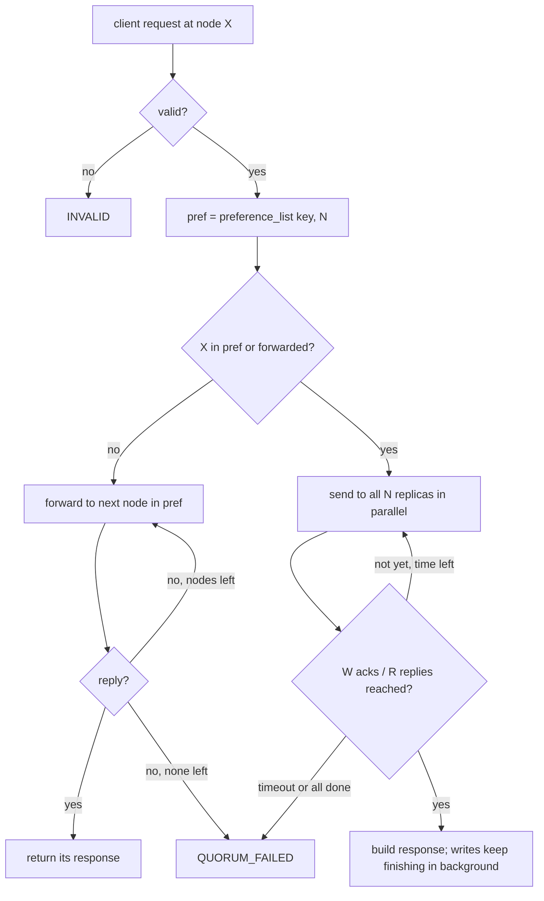
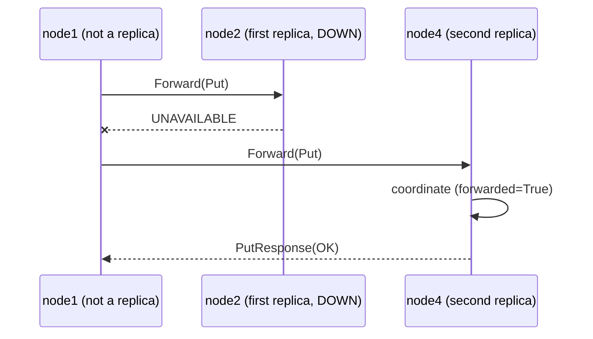

# 2.5 — Coordinator

## What we are doing

Building `coordinator.py`, the heart of Phase 2. For every client request it:

1. decides **which node coordinates** the request (routing and forwarding)
2. sends the request to the key's **N replicas in parallel**
3. waits for **W** acks (writes) or **R** replies (reads)
4. picks the **newest version** among the replies and answers the client

## What we implement

### Interface

```python
class Coordinator:
    def __init__(self, self_id, config, ring, storage, peers) -> None: ...

    async def handle_put(self, req: PutRequest, forwarded: bool) -> PutResponse: ...
    async def handle_get(self, req: GetRequest, forwarded: bool) -> GetResponse: ...
    async def handle_delete(self, req: DeleteRequest, forwarded: bool) -> DeleteResponse: ...
```

`KVStore.Put/Get/Delete` call these with `forwarded=False`. `NodeService.Forward` calls them with `forwarded=True`.

### Step 1: validation and quorum values

| Check | Result |
|-------|--------|
| Key empty or longer than 256 bytes, value larger than 1 MiB | `INVALID` |
| `w` / `r` is 0 | Use the config default |
| `w` / `r` greater than N | `INVALID` |

### Step 2: routing

```
pref = ring.preference_list(key, N)

if self_id in pref or forwarded:
    coordinate here
else:
    for node in pref:
        try: return await peers.forward(node, request, request_timeout)
        except RpcError: try next node
    return QUORUM_FAILED
```

| Rule | Why |
|------|-----|
| If this node is a replica, it coordinates itself | Saves a network hop. Any replica may coordinate in Dynamo. |
| Otherwise forward to the first replica, then the next on failure | Survives a dead first replica without any failure detector |
| A forwarded request is **never** forwarded again | Prevents loops if two nodes ever disagree about the ring |

### Step 3a: quorum write (`Put` and `Delete`)

1. Build the version:

   ```python
   ts = max(now_ms(), self.last_ts + 1)
   self.last_ts = ts
   version = Version(value, ts, self_id, tombstone)
   ```

   `max(..., last_ts + 1)` keeps timestamps from one coordinator strictly increasing, even when two writes land in the same millisecond or the clock steps backwards.

2. Start one task per replica in `pref`:
   - own node: `to_thread(storage.apply, key, version)`
   - other nodes: `peers.replica_put(node, key, version, rpc_timeout)`
3. Go through the tasks as they finish (`asyncio.as_completed`), counting successful acks and recording which nodes acked.
4. As soon as acks reach **W**, return `OK` with `written_to` = the nodes that acked so far.
5. If every task finished, or `request_timeout` passed, with fewer than W acks, return `QUORUM_FAILED`.
6. **Do not cancel the remaining tasks** after returning OK. They keep running, so the slower replicas still receive the write. Keep a reference to them in a `set` on the coordinator until they finish, otherwise Python may garbage-collect a running task.

A write that returns `QUORUM_FAILED` is **not rolled back**: replicas that stored it keep it. This is how Dynamo behaves, and the client must treat `QUORUM_FAILED` as "unknown", not "did not happen". Retrying is safe because the retry gets a newer timestamp.

### Step 3b: quorum read (`Get`)

1. Send `ReplicaGet` to **all N** replicas in parallel (own node via `to_thread(storage.get_version)`).
2. Count every reply that is not `Failed` (a "not found" reply counts as an answer).
3. As soon as **R** answers have arrived, stop waiting.
4. Among the versions received, keep the newest by `is_newer`.
5. Respond:

| Newest version | Response |
|----------------|----------|
| None (nobody has the key) | `NOT_FOUND` |
| A tombstone | `NOT_FOUND` |
| A value | `OK`, `values=[value]` |

   `read_from` = the nodes that answered.
6. Fewer than R answers before `request_timeout` → `QUORUM_FAILED`.

Asking all N but waiting only for R gives the fastest R answers instead of R fixed nodes, so one slow replica does not slow down reads.

Phase 2 does **not** fix stale replicas it notices during a read. That is read repair, added in Phase 3.

### Logging

One line per coordinated request:

```
node2 PUT cart:42 pref=[node2,node4,node5] acks=2/3 w=2 OK 4.2ms
node4 GET cart:42 pref=[node2,node4,node5] replies=2/3 r=2 OK 1.9ms
node1 PUT cart:42 forwarded->node2 OK 6.0ms
```

## How we implement it

1. Write `Coordinator` with the routing helper, `_quorum_write` and `_quorum_read`.
2. Wire `KVStore.Put/Get/Delete` to the coordinator instead of local storage.
3. Implement `NodeService.Forward`: unpack the `oneof`, call the matching `handle_*` with `forwarded=True`, pack the response.
4. Put both timeouts (`rpc_timeout_ms` per replica call, `request_timeout_ms` per request) into every wait. A request must never hang.

## Flow





## Tests

Run with the in-process 5-node cluster from 2.6.

- [ ] Put through a replica node: that node coordinates (check the log or `written_to`)
- [ ] Put through a non-replica node: request is forwarded and succeeds
- [ ] First replica stopped, request at a non-replica node: forwarded to the second replica
- [ ] `written_to` has at least W nodes, all from the preference list
- [ ] After a short wait, all 3 replicas have the version (`LocalGet`), the other 2 nodes do not
- [ ] Two puts to the same key through different nodes: `Get` returns the second
- [ ] Two puts from the same coordinator in the same millisecond get increasing timestamps
- [ ] `--r 4` / `--w 4` with N=3 gives `INVALID`; `0` uses the default
- [ ] A request never takes longer than `request_timeout_ms` + a small margin, even with 2 replicas stopped

## Done when

- [ ] All tests above pass
- [ ] Client `Put` / `Get` / `Delete` on any node behave the same
