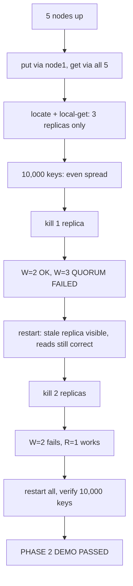

# 2.6 — Cluster, CLI, Tests and Demo

## What we are doing

Putting the cluster together and proving it works:

1. **CLI updates** for the new features and debug calls.
2. A **5-node Docker Compose** setup.
3. An **in-process cluster fixture** and the cluster tests.
4. Helper scripts and the **Phase 2 demo**.

## What we implement

### CLI changes (`client/cli.py`)

New commands and flags:

```
kv [--node HOST:PORT] put KEY VALUE [--w N] [-v]
kv [--node HOST:PORT] get KEY [--r N] [-v]
kv [--node HOST:PORT] delete KEY [--w N] [-v]
kv [--node HOST:PORT] info
kv [--node HOST:PORT] locate KEY
kv [--node HOST:PORT] local-get KEY
```

| Command / flag | Output |
|----------------|--------|
| `-v` on put / delete | `OK (written to node2, node4)` |
| `-v` on get | `book (read from node4, node5)` |
| `info` | node ID, N/R/W, member list, local key count |
| `locate KEY` | `cart:42 -> node2, node4, node5 (ring position 1938201)` |
| `local-get KEY` | `book  ts=1759571234123 writer=node2`, or `tombstone ts=…`, or `NOT FOUND` |

Exit codes (one new row):

| Situation | Prints | Exit |
|-----------|--------|------|
| Success | value or `OK` | 0 |
| `get` / `local-get` missing | `NOT FOUND` | 1 |
| `INVALID` | `INVALID REQUEST` | 2 |
| Unreachable | `ERROR: cannot reach HOST:PORT` | 3 |
| **`QUORUM_FAILED`** | `QUORUM FAILED` | **4** |

### `docker-compose.yml`

```yaml
x-node: &node
  build: .
  image: dynamo-kv:phase2
  volumes:
    - ./data:/data
  environment: &env
    CONFIG: /app/cluster.yaml
    DATA_DIR: /data

services:
  node1:
    <<: *node
    environment: { <<: *env, NODE_ID: node1 }
    ports: ["50051:50051"]
  node2:
    <<: *node
    environment: { <<: *env, NODE_ID: node2 }
    ports: ["50052:50051"]
  node3:
    <<: *node
    environment: { <<: *env, NODE_ID: node3 }
    ports: ["50053:50051"]
  node4:
    <<: *node
    environment: { <<: *env, NODE_ID: node4 }
    ports: ["50054:50051"]
  node5:
    <<: *node
    environment: { <<: *env, NODE_ID: node5 }
    ports: ["50055:50051"]
```

| Detail | Why |
|--------|-----|
| Every container listens on 50051 inside | `cluster.yaml` can use `nodeX:50051`; Docker's DNS resolves the service names |
| Host ports 50051–50055 | Lets the CLI on your laptop reach each node: `--node localhost:50054` is node4 |
| One shared `./data` mount | Each node writes to its own `/data/<node_id>/`, so folders never clash |

### Scripts

| Script | Does |
|--------|------|
| `scripts/bulk_write.py --nodes localhost:50051,…,localhost:50055 --count 10000 --prefix bulk` | Writes keys, sending each one to a random node; `--verify` reads them all back; `--w` / `--r` pass through |
| `scripts/key_spread.py --nodes …` | Calls `ClusterInfo` on each node and prints a key count table with each node's share and its ratio to the average |
| `scripts/demo_phase2.sh` | The demo below |
| `scripts/ring_stats.py` (optional) | Prints `owned_share()` for vnodes = 1, 8, 32, 128 to show why virtual nodes help |

### In-process test cluster (`tests/conftest.py`)

An async fixture that:

1. Picks 5 free ports and writes a temporary config with `localhost` addresses and short timeouts (`rpc_timeout_ms: 200`, `request_timeout_ms: 800`).
2. Starts 5 nodes with `start_node` (from 2.4) in the test's event loop, each with its own `tmp_path` folder.
3. Yields a `Cluster` object with `client(node_id)` (a `KVStoreStub`), `stop(node_id)`, `restart(node_id)` and `pref(key)`.
4. Stops every node at the end.

Running nodes in one process makes cluster tests fast (seconds, not minutes) and lets tests stop and restart nodes precisely.

## How we implement it

### Cluster tests (`tests/test_cluster.py`)

Basic behaviour:
- [ ] Put via node1, get via each of the 5 nodes: same value
- [ ] Exactly the 3 nodes from `pref(key)` have the key (`LocalGet`), after a short wait
- [ ] Delete via one node, get via another: `NOT_FOUND`
- [ ] 200 concurrent puts spread over all nodes: all `OK`, all readable

Failures with N=3, R=2, W=2:
- [ ] One replica stopped: put and get both succeed
- [ ] One replica stopped, `w=3`: `QUORUM_FAILED`
- [ ] Two replicas stopped: put with `w=2` gives `QUORUM_FAILED`; get with `r=1` succeeds if the surviving replica has the key
- [ ] A put that returned `QUORUM_FAILED` is still stored on the replica that acked it (documents "no rollback")

Versions and tombstones:
- [ ] Stop replica X, update the key, restart X: `LocalGet` on X shows the **old** value (stale replica, a known Phase 2 gap)
- [ ] In the same state, `get` with `r=2` and with `r=3` both return the new value, because any 2 of the 3 replicas include at least one up-to-date one and the newest version wins
- [ ] Stop replica X, delete the key, restart X: `get` with `r=3` returns `NOT_FOUND` (tombstone beats the stale value)

### Demo script (`scripts/demo_phase2.sh`)

`set -uo pipefail`, numbered headers, each check prints PASS or FAIL.

1. **Start clean:** `docker compose down`, `rm -rf ./data`, `docker compose up -d --build`, wait until all 5 nodes answer `kv info`.
2. **Any node, same answer:** `kv --node :50051 put cart:42 book -v`, then `kv get cart:42 -v` against each of the 5 ports.
3. **Where does it live:** `kv locate cart:42`, then `kv local-get cart:42` on all 5 nodes. Exactly 3 have it.
4. **Even spread:** `bulk_write.py --count 10000`, then `key_spread.py`. Every node holds about 6,000 keys (10,000 × 3 copies ÷ 5 nodes); check no node is above 1.5× the average.
5. **One node down:** find the first node in `locate cart:42`, `docker compose kill` it.
   - `put cart:42 pen` with default quorum → OK
   - `get cart:42` → `pen`
   - `put cart:42 pen --w 3` → `QUORUM FAILED` (exit 4)
6. **The Phase 2 gap:** restart the killed node. `local-get cart:42` on it shows `book`, the stale value. `get cart:42` still returns `pen`, because R=2 always includes an up-to-date replica. Print: *"stale replica stays stale: fixed by read repair (Phase 3) and hinted handoff (Phase 4)"*.
7. **Two replicas down:** kill 2 of the key's 3 replicas.
   - `put … --w 2` → `QUORUM FAILED`
   - `get … --r 1` → still answers
8. Restart everything and run `bulk_write.py --verify`. All 10,000 keys read back correctly.
9. Print `PHASE 2 DEMO PASSED` if every check passed, otherwise list the failed checks and exit 1.

## Flow



## Done when

- [ ] `pytest -v tests/` passes, including all Phase 1 tests updated to the new interfaces
- [ ] `docker compose up` starts 5 healthy nodes
- [ ] `scripts/demo_phase2.sh` prints `PHASE 2 DEMO PASSED`
- [ ] Phase 2 checklist in `phase2/README.md` is fully ticked
