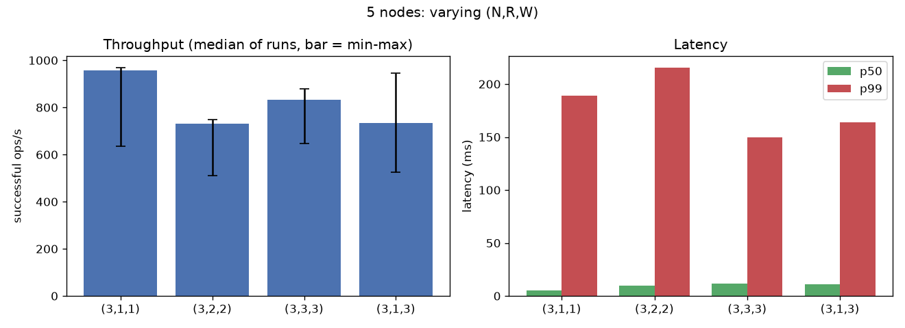
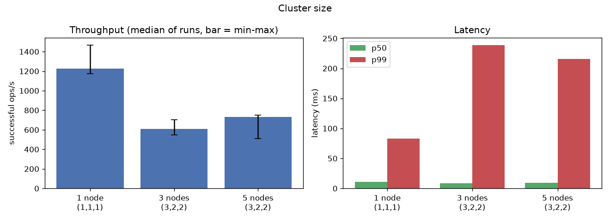
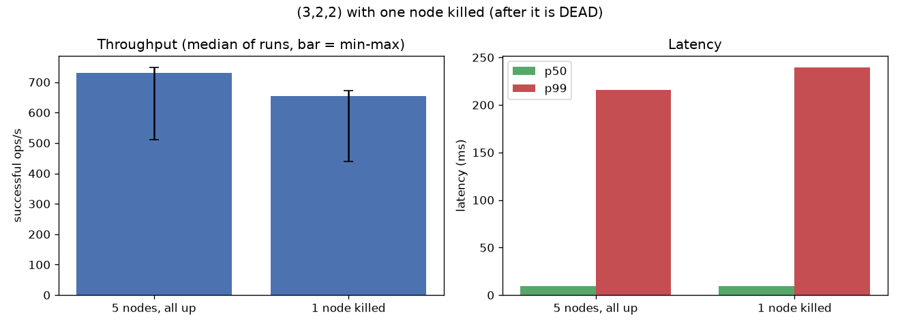
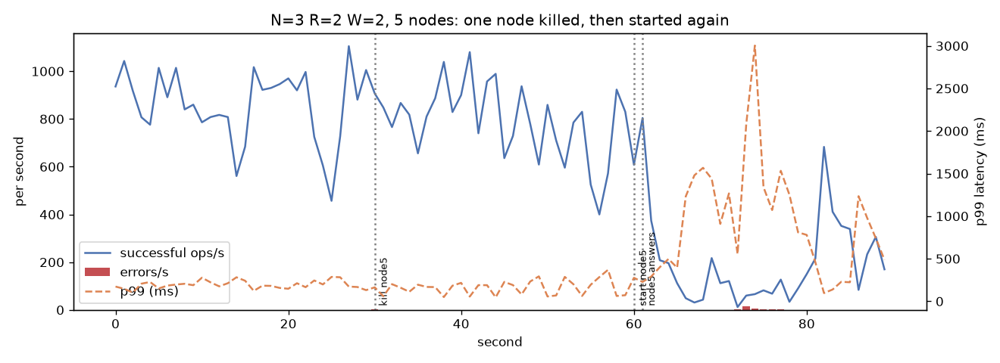

# Benchmark results

Measured with `python -m tools.bench run` and drawn with `python -m tools.bench plot`
(raw numbers: `bench.csv`, `timeline.csv`; machine: `machine.txt`).

**Workload:** 50 % get / 50 % put, 1 KB values, 10,000 keys (preloaded), 16 clients,
10 s warm-up, then 60 s measured, 3 runs per setting. Each client sends one request to a random
node, waits for the reply, then sends the next (closed loop). Puts carry the last context seen
for the key, like a real client.

**Setup:** the load generator and every node run as local processes on one laptop
(Intel i5-1245U, 12 threads, 30 GiB, Linux, Python 3.14). Node data is on the laptop's SSD
(ext4), so every log write pays a real fsync. Timers are the production ones from
`cluster.local.yaml` (gossip 1 s, SUSPECT 5 s, DEAD 10 s, RPC timeout 500 ms, request budget
1.5 s, anti-entropy every 10 s).

## Read these numbers with care

- **Run-to-run noise is large** (often ±25 %, see the min–max bars). The laptop's 15 W CPU and
  its power management move the numbers more than some of the settings do.
- **Closed loop hides queueing delay** ("coordinated omission"): a client stuck on a slow reply
  sends nothing meanwhile, so a fixed-rate load would see a worse p99 than shown here.
- **One machine:** "5 nodes" share the same CPUs and disk; adding nodes adds no hardware. The
  client used about 0.3–0.5 of one core, so the client was not the bottleneck.
- Errors are QUORUM_FAILED or timeouts; they are counted but not in ops/s.

## Summary (median run of 3)

| Setting | ops/s | p50 ms | p99 ms | errors in that run |
|---|---|---|---|---|
| 5 nodes, (N,R,W) = (3,1,1) | 956 | 5.3 | 189 | 0 |
| 5 nodes, (3,2,2) | 732 | 9.6 | 216 | 2 |
| 5 nodes, (3,3,3) | 833 | 11.4 | 150 | 34 |
| 5 nodes, (3,1,3) | 733 | 10.9 | 164 | 56 |
| 5 nodes, (3,2,2), 1 node killed (after DEAD) | 654 | 9.7 | 240 | 0 |
| 3 nodes, (3,2,2) | 611 | 8.6 | 239 | 37 |
| 1 node, (1,1,1) | 1227 | 10.8 | 83 | 0 |

## Graphs

### Varying (N,R,W) — `nrw.png`


**Takeaway:** the median latency follows the quorum size: p50 is 5.3 ms when the coordinator
waits for 1 replica and about 10–11 ms when it waits for 2 or 3, because it has to wait for the
slower one. Throughput differences between (3,2,2), (3,3,3) and (3,1,3) are inside the noise.
Only W=3 / R=3 settings produced QUORUM_FAILED errors: one slow replica is enough to miss the
deadline when every replica must answer.

### Cluster size — `cluster_size.png`


**Takeaway:** one node (N=1) is the fastest, because every request is one local write instead of
three replica calls. With replication the work per request triples while the hardware stays the
same, so on one laptop 3 and 5 nodes are slower than 1; they buy fault tolerance, not speed.
5 nodes beat 3 (732 vs 611 ops/s) because the same work is spread over more processes.

### One node killed — `killed.png`


**Takeaway:** with one of five nodes DEAD, (3,2,2) keeps serving every request (0 errors in the
median run) at about 10 % lower throughput: the two live owners still make R=2 / W=2, and sloppy
quorum puts a stand-in in place of the dead owner.

### Kill and restart over time — `timeline.png`


**Takeaway:** killing a node at 30 s causes no visible dip: with N=3 and W=2 the coordinator
does not wait for the dead replica's timeout. The **restart** at 60 s is what hurts: for about
20 s throughput falls from ~800 to 30–200 ops/s, p99 rises to 1–3 s and a few requests fail.
The likely cause is catch-up work all landing at once on the restarted node — hinted handoff
delivering ~30 s of writes one call at a time, read repair on every stale key it is asked about,
and anti-entropy — each write with its own fsync. The cause is not yet isolated; see the
review list.

## How to rerun

```
python -m tools.bench run                     # everything, about 30 minutes
python -m tools.bench run --only nrw-3-2-2 --duration 10 --reps 1   # quick check
python -m tools.bench run --existing localhost:50051,localhost:50052,localhost:50053,localhost:50054,localhost:50055 --only nrw-3-2-2   # a running cluster, e.g. Docker
python -m tools.bench plot                    # redraw the graphs (needs matplotlib)
```
